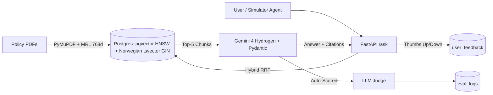

# Norwegian Insurance Policy RAG & Automated Evaluation

Production-oriented RAG pipeline over Norwegian insurance policy terms (*forsikringsvilkår*), built without black-box orchestration wrappers. Features hybrid retrieval in PostgreSQL, strict Pydantic citation/refusal enforcement, closed-loop user feedback, and an automated User Simulator + LLM Judge evaluation suite.

## Architecture
- **Storage & Retrieval (`src/ingestion/`, `src/retrieval/`):** PostgreSQL 16 + `pgvector` (768-dim `gemini-embedding-2-preview` with HNSW index) + native Norwegian full-text search (`to_tsvector('norwegian', ...)` with GIN index), merged via Reciprocal Rank Fusion (RRF).
- **Grounded Generation (`src/generation/rag.py`):** `gemini-4-hydrogen` (`thinking_level="low"`) returning strict Pydantic schemas with `[doc_name, page_number, quote]` citations and explicit refusal when context is insufficient.
- **Automated Evaluation (`src/evals/run_eval.py`):**
  - **User Simulator Agent:** Generates fixed, reproducible Norwegian test queries (`data/eval_set.json`) across exact clause lookups, informal customer scenarios, exclusion edge cases, and unanswerable traps.
  - **LLM Judge Agent:** Scores Faithfulness and Relevance and logs every run to `eval_logs` in Postgres.
- **API & Feedback (`src/api/app.py`):** FastAPI service with `/health`, `/ask`, and `/feedback` (logging thumbs-up/down ratings to `user_feedback`).

## System Flow


## Benchmark Results (18 Norwegian Policy Queries: 15 Hard + 3 Unanswerable Traps)

| Mode | Thinking Level | Recall@5 | Faithfulness | Relevance | Avg Latency |
| :--- | :--- | :---: | :---: | :---: | :---: |
| `vector` (baseline) | default | 1.00 | 1.00 | 1.00 | 11,882 ms |
| `vector` | `low` | 1.00 | 1.00 | 1.00 | **3,180 ms** |
| `hybrid` (RRF) | `low` | 1.00 | 1.00 | 1.00 | 4,138 ms |

*Key engineering takeaways:*
- Tuning `thinking_level="low"` cut p50/avg latency by **~73%** (11.9s $\rightarrow$ 3.2s) with zero drop in faithfulness or refusal accuracy.
- Future improvements: cross-model judging (e.g., Claude judging Gemini) to eliminate self-preference bias, and adding a cross-encoder reranker on larger multi-product policy corpora.

## Quickstart
```bash
docker compose up -d
python3 -m venv .venv && source .venv/bin/activate
pip install -r requirements.txt
# Add GEMINI_API_KEY and DATABASE_URL to .env, and drop PDFs in data/policies/
python -m src.ingestion.ingest
python -m src.evals.run_eval
uvicorn src.api.app:app --reload
python -m pytest -v